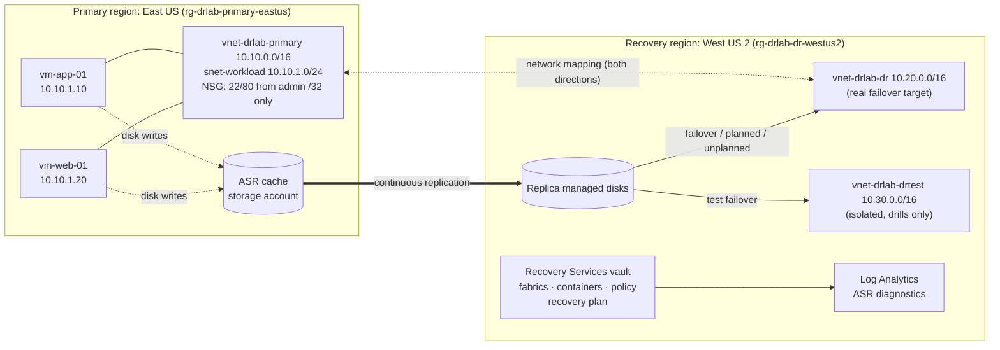
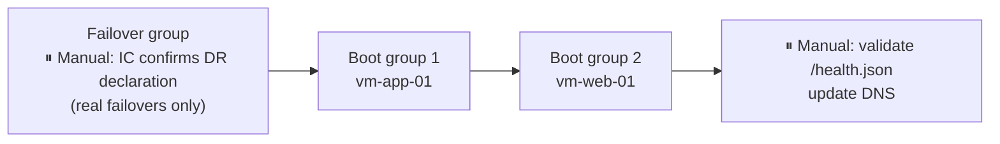

# Azure Multi-Region Disaster Recovery with Azure Site Recovery

> Project 8 (Advanced Azure) from [AWS-GCP-Azure-Cloud-Projects-Workshop](https://github.com/NotHarshhaa/AWS-GCP-Azure-Cloud-Projects-Workshop#project-8-designing-a-multi-region-disaster-recovery-plan), built end-to-end as Infrastructure as Code.

This project protects a two-tier Linux workload in **East US**. **Azure Site Recovery (ASR)** replicates it continuously to **West US 2**. An ordered **recovery plan** fails the whole workload over with one action. **Scripted DR drills** run test failovers in an isolated network and measure the RTO and RPO actually achieved.

| | |
|---|---|
| **Objective** | Replicate VMs, configure cross-region failover, and build a recovery plan that keeps downtime low |
| **Stack** | Terraform (azurerm 5.x), Azure Site Recovery, Recovery Services vault, VNets/NSGs, Log Analytics, PowerShell (Az.RecoveryServices), GitHub Actions (OIDC) |
| **Targets** | RPO ≤ 15 min · RTO ≤ 60 min (see [DR plan](docs/DR-PLAN.md)) |
| **Achieved (drill 2026-11-03)** | **RTO 6 min 25 s** · **RPO ≈ 3.4 min** · PASS ([report](evidence/drills/drill-20261103-173851.md)) |
| **Skills** | DR planning, multi-region architecture, ASR, IaC, DR-as-code testing, least-privilege network design |

---

## Architecture



**Recovery plan order** (`rp-drlab-eastus-to-westus2`):



### Design decisions

| Decision | Why |
|---|---|
| Vault, logs, and DR network live in the **recovery** region | If East US is down, the control plane you need to fail over is not down with it. |
| **Isolated test VNet** (`10.30.0.0/16`, no peering) | Drills never collide with production IPs or DNS. You can test monthly without a change window. |
| **Non-overlapping** address spaces + **static IPs per VM per environment** | Predictable addressing after failover. The DR VNet can later be peered to a hub without re-IPing. |
| **Reverse container + network mappings created upfront** | Re-protect and failback don't require building infrastructure mid-incident. |
| **Multi-VM consistency group** | The app and web tiers recover to the *same* point in time. |
| **Pre-staged Standard public IPs** in DR and test | No manual IP work in the recovery path. Standard SKU is closed by default, and NSGs allow only the admin /32. |
| Manual actions gate **real** failovers only | A human declares a disaster. Drills stay fully automated. |
| Status page rebuilt from **IMDS on every boot** | `/health.json` reports the region the VM is actually running in, which proves the failover. |

---

## Repository layout

```
terraform/
  versions.tf          provider pins, features (teardown-friendly for ASR)
  variables.tf         inputs with validation (no 0.0.0.0/0 allowed)
  locals.tf            VM map, CIDRs, tags
  network.tf           RGs, 3 VNets, NSGs, public IPs
  compute.tf           2x Ubuntu 22.04 VMs (app, web, Standard_E2bs_v5) + cloud-init
  site-recovery.tf     vault, cache SA, fabrics, containers, policy, mappings, replicated VMs
  rbac.tf              vault managed identity -> cache storage roles (+ propagation wait)
  recovery-plan.tf     ordered recovery plan with manual gates
  monitoring.tf        Log Analytics + vault diagnostic settings
  outputs.tf           endpoints + ready-to-run drill command
  cloud-init/status-page.yaml
scripts/
  dr-drill.sh                health | drill | cleanup via az CLI only (used for the recorded drill)
  Start-DrDrill.ps1          test failover -> measure RTO -> evidence -> cleanup
  Invoke-Failover.ps1        real planned/unplanned failover + commit
  Get-ReplicationHealth.ps1  health/RPO check (non-zero exit on breach)
  AsrHelpers.ps1
docs/
  DR-PLAN.md                 the DR plan: scope, RTO/RPO, roles, runbooks, failback
evidence/                    screenshots + drill reports
.github/workflows/
  terraform-ci.yml           fmt, validate, tflint, Checkov
  dr-drill.yml               on-demand/scheduled test failover via OIDC
```

---

## Deploy

**Prerequisites:** Azure subscription with Owner/Contributor rights, Terraform ≥ 1.9, Azure CLI, PowerShell 7 with `Az.Accounts` and `Az.RecoveryServices`.

```bash
az login
az account set --subscription <SUBSCRIPTION_ID>
az provider register --namespace Microsoft.RecoveryServices --wait

cd terraform
cp terraform.tfvars.example terraform.tfvars   # set subscription_id, allowed_source_cidr, admin_ssh_public_key
terraform init
terraform plan -out tfplan
terraform apply tfplan                           # ~45-90 min: initial replication is the long pole
```

Check that replication is healthy before you drill:

```powershell
Connect-AzAccount
./scripts/Get-ReplicationHealth.ps1 -ResourceGroupName <dr_resource_group> -VaultName <recovery_vault_name>
```

## Run a DR drill (non-disruptive)

**Bash / Git Bash (recommended, uses your `az login`, reads names from `terraform output`):**

```bash
scripts/dr-drill.sh health    # both VMs must be Normal / Protected
scripts/dr-drill.sh drill     # test failover + RTO/RPO report in evidence/drills/
scripts/dr-drill.sh cleanup   # delete the test VMs
```

**PowerShell (Az modules):**

```bash
terraform output -raw drill_command   # copy, then run in pwsh
```

The drill:
1. Aborts if any VM isn't Healthy/Protected.
2. Starts a **test failover** of the recovery plan into `vnet-drlab-drtest`. Production keeps running.
3. Waits for the ASR job, then polls the recovered web VM's `/health.json` until it reports `westus2`.
4. Writes a report with achieved **RTO**, **RPO**, and PASS/FAIL to `evidence/drills/drill-<timestamp>.md`.
5. Cleans up the test VMs (`-SkipCleanup` keeps them so you can inspect them).

You can also run it from GitHub: **Actions → dr-drill → Run workflow**. The workflow uses OIDC, so there are no stored secrets.

## Real failover / failback

See [docs/DR-PLAN.md](docs/DR-PLAN.md) sections 5–6. Summary:

```powershell
./scripts/Invoke-Failover.ps1 -ResourceGroupName <rg> -VaultName <vault> -RecoveryPlanName <plan> -Type Unplanned
# then re-protect (West US 2 -> East US) and fail back with -Type Planned -Direction RecoveryToPrimary
```

## Teardown

Delete ASR test or failover artifacts first (run a drill cleanup or commit), then:

```bash
terraform destroy
```

`prevent_deletion_if_contains_resources = false` and `purge_protected_items_from_vault_on_destroy = true` let destroy remove the ASR-created replica disks and the vault. Afterwards, confirm in the portal that both resource groups are gone.

---

## Results

Deployed, drilled, and torn down on **2026-11-03** (East US → West US 2, 2× Standard_E2bs_v5).

| Metric | Target | Achieved |
|---|---|---|
| Initial replication ("Enable replication" job, per VM) | n/a | 10 min 56 s (web) / 11 min 59 s (app) |
| Steady-state RPO at drill start | ≤ 15 min | **185–201 s (≈ 3.4 min)** |
| Test failover RTO (ASR job, both tiers, ordered boot) | ≤ 60 min | **6 min 25 s** |
| App healthy in DR (`/health.json` → `westus2`, new vmId) | ≤ 60 min | ✅ web VM booted in DR 5 min 48 s after start |
| Test failover cleanup | – | Succeeded (~2 min) |
| Teardown | 0 resources left | ✅ both resource groups deleted |

Proof that it ran in the recovery region: before the drill, `/health.json` on the primary web VM returned `"region":"eastus","vmId":"47690440-…"`. During the drill, the test-failover VM returned `"vm":"vm-web-01-test","region":"westus2","vmId":"9fbbdf54-…"`, which is a different VM, built from the replicated disk.

See [evidence/README.md](evidence/README.md) for the screenshot checklist.

## Troubleshooting

### Known pitfalls (checked against docs before deployment)

| Symptom | Cause | Fix |
|---|---|---|
| Enable replication fails with Mobility Service / connectivity error (e.g. 151037 / 151196) | VM can't reach ASR endpoints outbound | Default NSG outbound allows this. If you lock outbound down, allow service tags `AzureSiteRecovery`, `Storage.<source region>`, `AzureActiveDirectory`, `EventHub`, `GuestAndHybridManagement`. |
| Replication stuck at 0% / "waiting for first recovery point" | Initial sync is still running | Normal for 30–60+ min. Check with `Get-ReplicationHealth.ps1`. Don't destroy mid-sync. |
| `terraform destroy` fails on the DR resource group | ASR-created disks/NICs not in state | Already handled by the provider `features` block. If test failover VMs exist, run cleanup first. |
| Test failover VM isn't reachable on its public IP | NSG allows only `allowed_source_cidr`, or your IP changed | Update `allowed_source_cidr` and `terraform apply`. |
| `/health.json` still says `eastus` after failover | Status service didn't run at boot | Check with the serial console (boot diagnostics are enabled): `systemctl status dr-status-page`. |
| Multi-VM consistency warnings | Port 20004 blocked between group members | Intra-VNet traffic is allowed by default NSG rules. Make sure no host firewall blocks 20004. |

### Issues hit during my deployment

| # | Symptom | Root cause | Fix |
|---|---|---|---|
| 1 | `SkuNotAvailable … Capacity Restrictions: Standard_B2s … not available in location 'eastus'` (409) after the vault, networks, and ASR fabric were already built | Live regional capacity shortage for B-series in East US | Partial apply is safe. Terraform kept everything that succeeded, so only the VM size needed to change. Re-plan showed only the remaining resources. |
| 2 | Every B-series size (B1ms/B2s/B2ms) then showed `NotAvailableForSubscription` in 6 US regions; newer families (Bsv2, DSv5…) showed **quota 0** | Free-tier subscription: an allow-list of sizes plus per-family vCPU quotas. `restricted = 0` does not mean "has quota". | Checked both at once: `az vm list-skus -l <region>` (without `--all` hides blocked sizes) and ``az vm list-usage --query '[?limit != `"0"`]'`` (note: `limit` is a string). Chose **Standard_E2bs_v5**: offered and quota 10 in **both** regions, v5/SCSI (avoided NVMe-only v6 families for ASR). |
| 3 | Enable replication failed: **error 28143** "Recovery Services vault does not have permission to access storage account" | The vault has a **system-assigned managed identity**, so ASR authenticates to the cache storage account **as that identity**, which had no roles | Added `rbac.tf`: **Contributor** + **Storage Blob Data Contributor** for the vault identity on the cache account, a 120 s `time_sleep` for Entra propagation, and `depends_on` from the replicated VMs. The Site Recovery jobs view shows `Enable replication: Failed` (11:03) then `Succeeded` (11:16). |
| 4 | `Connect-AzAccount` never showed an account picker and returned without a context; scripts "not digitally signed" | `pwsh` hosted inside Git Bash's mintty breaks interactive auth (WAM). Files extracted from a downloaded zip carry Mark-of-the-Web. | `Unblock-File`. Then I stopped depending on Az PowerShell locally: wrote `scripts/dr-drill.sh`, which drives the ASR REST API through `az rest` with the existing `az login`. |
| 5 | Drill script kept printing `Succeeded` and never exited | `az` on Windows emits CRLF, so the captured `"Succeeded\r"` never matched `Succeeded)` in a bash `case` | Strip `\r` from every `az … -o tsv` capture (`tr -d '\r'`). Also `MSYS_NO_PATHCONV=1` so Git Bash doesn't rewrite `/subscriptions/...` into `C:/...`. |
| 6 | `terraform destroy` failed on the vault: `polling after Delete: context deadline exceeded` after 30 min | Vault deletion waits for ASR to finish disabling replication and purging items. It continued server-side after Terraform's timeout. | Re-ran `terraform destroy`: the vault was already gone, and the remaining resource group deleted in 17 s. Verified with `az group list --query "[?starts_with(name,'rg-drlab')]"` → empty. |

---

## Production hardening roadmap

- Customer-managed keys (CMK) on the vault and on replica disks (`target_disk_encryption_set_id`)
- Private endpoints for the vault and the cache storage account, and outbound NSG rules restricted to ASR service tags
- Azure Front Door / Traffic Manager health-probe routing so DNS cutover isn't a manual step
- Azure Automation runbooks as recovery-plan actions (DNS update, app config swap)
- Zone-to-zone ASR within the primary region for cheaper protection against zonal failures
- Azure Policy to enforce "every prod VM tagged `dr_protected=true` must have replication enabled"

## Cost

ASR is billed per protected instance (Azure has historically included the first 31 days free per instance, so check current pricing). You also pay for replica disks, cache storage, 2× VMs, public IPs, and Log Analytics ingestion. The recorded run (about 4 hours from first apply to destroy) ran entirely on free-trial credit with the spending limit on. **Tear down after you collect evidence.**

## License

MIT. See [LICENSE](LICENSE).
